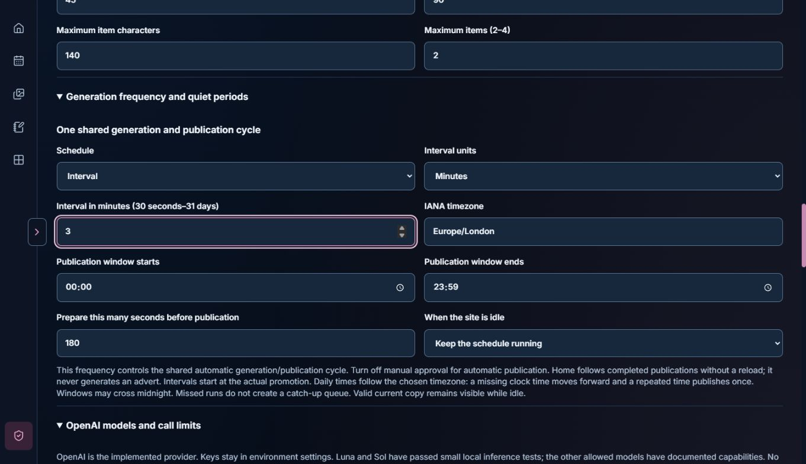
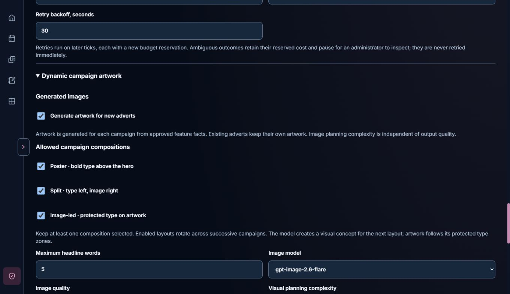
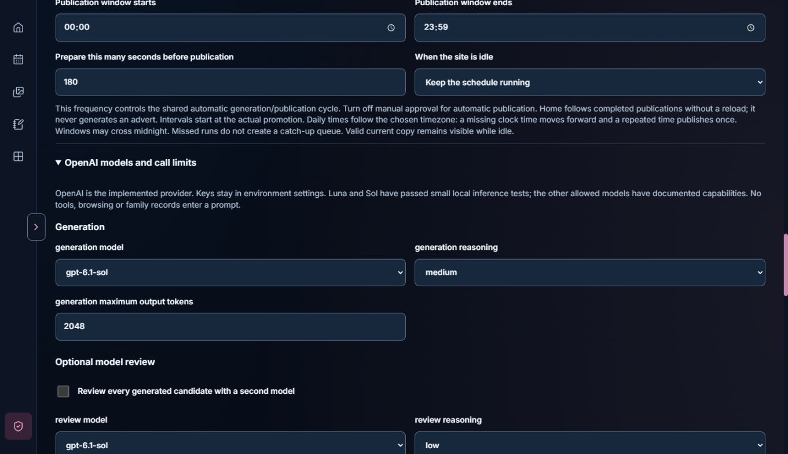
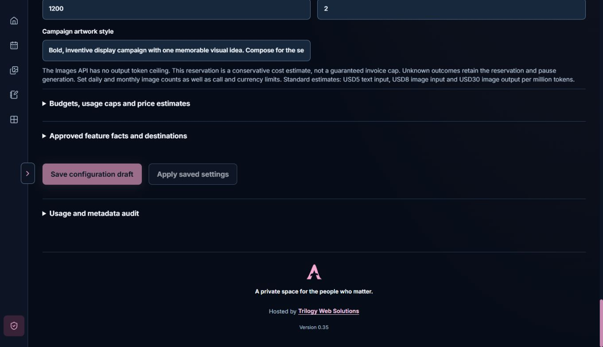

# Advertising administration: Gary's user guide

Use your existing administrator login. These settings control the shared feature advert on Home; they do not change family records.

The local setup established on 17 November 2026 uses a three-minute interval, 180-second preparation lead, all three layouts, Sol with medium reasoning and 2,048 output tokens, and Flare artwork with medium quality/complexity at square size. These are examples from that setup, not permanent defaults. Always check the values currently shown.

## 1. Open Advertising and check its status

1. Sign in as Gary/Dad and open **Administration**.
2. Select **Advertising**.
3. Read **Overview**, especially **Service**, **Last outcome**, **Next eligible publication** and **Engine work**.
4. Under **Current and successor**, **Current** is the published advert. **Candidate** is its prepared replacement; it may be awaiting approval or waiting for its publication time.

The admin page is a snapshot. Use **Reload settings** to fetch the latest status. If you have unsaved changes, the page asks before discarding them.

## 2. Set the frequency

Open **Generation frequency and quiet periods** under **Configuration draft**. There is one shared generation/publication schedule, rather than separate controls for generating and displaying adverts.

For an interval:

1. Set **Schedule** to **Interval**.
2. Choose **Interval units**: **Minutes** or **Seconds**.
3. Enter the interval. For example, `3` minutes means 180 seconds. The minimum is 30 seconds, which is `0.5` minutes; the maximum is 31 days. Switching units converts the displayed value without changing the interval.

Intervals run from the actual previous publication. A three-minute interval is an intended cadence, not a promise that slow or failed generation finishes within three minutes.

For a daily schedule:

1. Set **Schedule** to **Daily local time**.
2. Set **Daily publication time**.
3. Set **IANA timezone**, for example `Europe/London`. Use a timezone name rather than a fixed GMT offset so seasonal clock changes are handled. A missing clock time moves forwards; a repeated time publishes once.

For either schedule:

- **Publication window starts** and **Publication window ends** restrict when the automatic cycle can run. Windows can cross midnight. `00:00` to `23:59` covers the day.
- **Prepare this many seconds before publication** allows preparation ahead of the next due time. For example, `180` provides a three-minute lead. It does not create extra adverts or remove the publication interval.
- **When the site is idle** can **Keep the schedule running** or **Pause new preparation until someone returns**. For the latter, set **Idle after seconds without a Home visit**. Valid current copy remains visible. The idle policy also gates the automatic cycle while idle.

Finish with Save and Apply as described in step 5.

## 3. Choose the layouts and eligible services

Open **Dynamic campaign artwork** and leave **Generate artwork for new adverts** selected when you want images.

Under **Allowed campaign compositions**, select any combination of:

- **Poster · bold type above the hero**.
- **Split · type left, image right**.
- **Image-led · protected type on artwork**.

Keep at least one selected. Enabled layouts cycle across new campaigns; with one selected, every new image campaign uses that layout. The model creates fresh copy and artwork for the chosen layout. Changing the checkboxes does not redraw Current immediately.

**Maximum headline words** controls the short hook, from two to eight words; five is the current example. The separate headline character limit still applies.

To choose services, open **Approved feature facts and destinations**, then the relevant service. Its **Allow…** checkbox controls eligibility and its **selection weight** influences frequency. Equal weights give eligible services even coverage over time. Enter approved public feature facts only, never private family information.

## 4. Choose the text and image models

These are separate settings: the text model creates the campaign idea/copy, while the image model creates artwork.

Open **OpenAI models and call limits**:

1. Set **generation model** from the available choices. The current example is `gpt-6.1-sol`.
2. Set **generation reasoning**, for example `medium`. Available reasoning levels depend on the model; check this again after changing models.
3. Set **generation maximum output tokens**, for example `2048`. This limits the text response, not image output.
4. Check **Timeout per provider call, seconds**, **Retries after a known rejected attempt** and **Retry backoff, seconds**. Each retry can use another call and budget reservation. Uncertain outcomes pause rather than retry immediately.

For an extra text check, select **Review every generated candidate with a second model** and choose **review model**, **review reasoning** and **review maximum output tokens**. This adds a separate model call; it does not replace human approval when that is enabled.

In **Dynamic campaign artwork**, choose **Image model** separately. The current example is `gpt-image-2.6-flare`. Then check **Image quality**, **Visual planning complexity**, **Image size** and **Image timeout, seconds**. Quality and planning complexity are independent controls; the text model's reasoning setting does not set either. The current example uses medium/medium and **Square · 1024 × 1024**.

**Campaign artwork style** guides the visual treatment. **Maximum visual brief characters** bounds the brief. Turning future image generation off does not remove an already published image.

## 5. Save the draft, then apply it

1. Make all intended changes in **Configuration draft**.
2. Select **Save configuration draft**. This saves your draft; it does not make it active.
3. Wait for the success message.
4. Select **Apply saved settings**. This activates the saved draft and invalidates any prepared Candidate made with the old settings. Scheduling is updated.
5. Use **Reload settings** to confirm the applied values and status.

Save is disabled when the draft is unchanged. Apply is disabled while edits are unsaved or nothing saved differs from the active settings. Both are disabled while this page is processing an action. The screenshot shows an unchanged draft.

Current remains visible while it is still valid; disabling advertising, excluding its service or changing its approved facts can make it unavailable earlier. Applying does not itself guarantee immediate generation or publication. The worker must run and the schedule, approval and limits must permit the next cycle.

If a save reports a conflict or uncertain result, first copy or record your intended edits. **Reload settings** can replace your local draft after the discard confirmation. Reload only when ready, compare the saved/applied values with your notes, then decide whether to retry.

## 6. Run automatically, pause, or review manually

Under **Service, branding and formats**:

- **Enable advertising** allows the service to operate.
- **Pause preparation and publication** stops the cycle while retaining valid Current.
- Clear **Require manual approval for each candidate** for automatic publication. Leave it selected when you want to inspect each replacement first.

Changes to these draft checkboxes also need Save and Apply. The separate **Pause**, **Resume** and **Disable** buttons in **Current and successor** are direct actions, rather than draft edits. Unsaved edits must be dealt with first.

**Pause** keeps valid Current visible; **Disable** hides the spotlight, clears Current and Candidate, and prevents new paid work. Re-enabling needs new generation. A provider request already sent may still finish and be charged. **Resume** releases a pause, but does not override limits or restart a stopped worker.

For manual review, **Prepare candidate** can spend money. Inspect its copy and image, then **Approve** or **Reject**. **Publish eligible candidate** publishes an approved replacement only when eligible; approval and publication are separate.

## Limits and troubleshooting

Open **Budgets, usage caps and price estimates**. Check daily/monthly USD budgets and call, text-token and image-count limits: zero blocks the corresponding paid work. Counters use UTC day/month boundaries. Optional review and retries consume calls too.

**Estimated reservation per image, USD** is a conservative estimate, not a guaranteed invoice cap. The Images API has no output-token ceiling. Unknown outcomes retain reservations and can pause the service. Keep price check dates/rates current. **Usage and metadata audit** shows estimated usage and outcomes.

If adverts stop changing, check:

- **Pending draft:** did you both Save and Apply?
- **Paused/disabled/manual approval:** does a Candidate need approval?
- **Schedule:** is publication due and inside its window? Is the idle policy holding the cycle?
- **Limits:** are caps nonzero and available, and price estimates current?
- **Slow work:** does Engine work show preparation? Allow time for text and artwork; reload status before retrying.
- **Local worker:** Windows Task Scheduler now owns **The Allin Family - Local Advertising**, which starts at Gary's logon and recovers exited engine, callback and worker processes. You can close this chat or Home; neither owns those processes. Gary must stay logged in (locking is fine) and the PC must remain powered on. While plugged in, the manager prevents automatic idle sleep but allows the display to turn off. It releases that request on battery. Manual sleep, signing out or powering off can still interrupt the schedule; recovery may run a late cycle.

Use admin **Pause** to retain Current and stop preparation/publication while leaving the manager available. Manager **Stop** disarms recovery and drains its owned processes; **Resume** in admin cannot restart a stopped manager. Ask the operator to check manager status or enable it again when needed. The main local API and website must also be running.

Open Home follows complete new publications without a reload, normally checking while visible every 15 seconds. Browsing Home never starts paid generation.

**Check engine credentials** shows whether credentials are configured and the engine is available. It does not verify billing or access to every model. Provider keys remain in environment settings; there is no key-entry field here. Never paste keys into copy, style or feature-fact fields.
